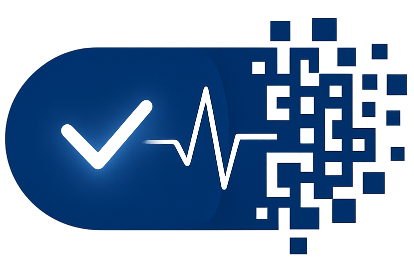
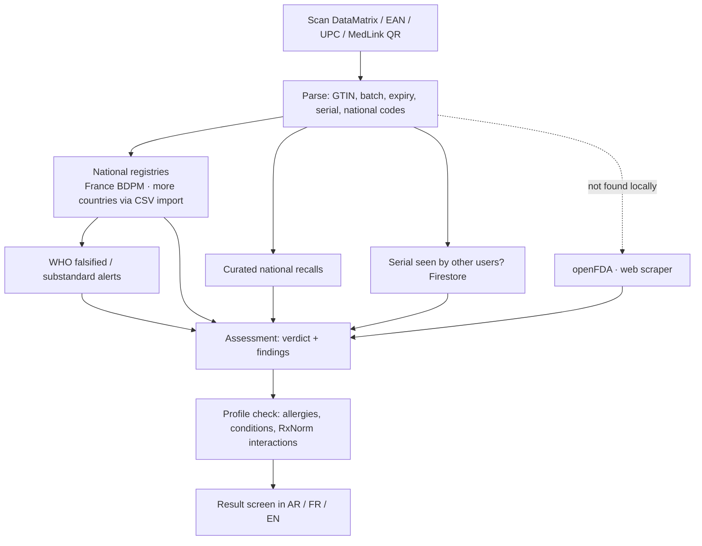

# MedLink

MedLink is a mobile app that helps people in Mauritania and the rest of North and West Africa check the medicines they buy. Scan the barcode on a box and MedLink tells you what the product is, whether a health authority has registered it, and whether anything about it should worry you: an expiry date, a recall, a WHO falsified-medicine alert, a barcode that doesn't add up, or a box code that has been copied onto other boxes. It also checks the medicine against your own allergies, conditions and current treatments.

Around it sit the everyday tools a patient needs: medication reminders, a health profile, and a map of nearby clinics, hospitals and pharmacies. The app is available in Arabic, French and English.



> MedLink supports decisions; it does not make them. A scan can't prove that a box is genuine, and MedLink never claims it can. If in doubt, ask a pharmacist.

## Why we're building it

In Mauritania, most medicines are imported, mainly from France, Morocco, Algeria, Tunisia, India and China, and they reach patients through a mix of pharmacies, depots and informal sellers. A box can look right and still be expired, recalled, out of authorisation, or fake. Patients rarely have a way to check.

The information that would help often already exists: France publishes every medicine it authorises, the WHO publishes alerts about falsified and contaminated batches found across Africa, and the box's own DataMatrix code carries its batch, expiry and a unique serial number. MedLink brings those sources together and turns them into one clear answer on the phone, in the patient's language.

## What a scan does

Point the camera at the box. MedLink reads the 2D DataMatrix on serialised packs or the regular EAN/UPC barcode, then:

1. **Decodes the code** — product number (GTIN), batch, expiry date, serial number, and national drug numbers such as French CIP13 or US NDC. It notes which country's GS1 office issued the barcode (Morocco 611, Algeria 613, Tunisia 619, Egypt 622, India 890…). That shows where the brand registered the barcode, not where the medicine was made.
2. **Looks the product up in national registries.** France is loaded in full (15,883 medicines from the official ANSM database), with the laboratory, active ingredients, and whether the product is still authorised and marketed. Because that list is complete, a French-format code that isn't on it is flagged.
3. **Checks recalls and WHO alerts.** That covers curated national recalls and 80 WHO Medical Product Alerts, including falsified Cytotec found in Niger and Nigeria, Combiart in Mali and Chad, and quinine and chloroquine across the Sahel. A shared active ingredient alone doesn't trigger a match; the brand, manufacturer or batch has to match too.
4. **Looks for cloned codes.** Every serialised box has a unique serial number. If the same serial is scanned by several different people, the code has probably been copied onto fakes.
5. **Checks the medicine against your profile:** allergies (across languages and drug classes, so a "penicillin" allergy catches amoxicillin), conditions, and drug–drug interactions via the NIH RxNorm database.
6. **Gives one verdict** with plain-language findings:

| Verdict | Meaning |
|---|---|
| **Do not use** | Expired, recalled, or the batch appears in a WHO alert |
| **Check with a pharmacist** | Something is wrong but not conclusive: not in the national register, authorisation withdrawn, malformed barcode, likely cloned code |
| **Registered product — no alerts found** | A health authority lists it and nothing matches it |
| **Not found** | We couldn't identify it. That doesn't mean it's fake |



## Data sources

| Source | What it gives us | Status |
|---|---|---|
| **France — BDPM (ANSM)** | Every medicine authorised in France, by CIP13 | Bundled, complete (snapshot 2026-10-30) |
| **WHO Medical Product Alerts** | Falsified and substandard products, manufacturers, countries, some batch numbers | Bundled, 80 alerts (snapshot 2026-10-30) |
| **National recalls** | ANSM, AMMPS, NAFDAC… recalls and batch withdrawals | Format ready, list still empty |
| **Morocco, Algeria, Tunisia, Mauritania, Senegal…** | National lists of authorised medicines | Importer ready, no data loaded yet |
| **NIH RxNorm** | Drug–drug interactions | Live API |
| **openFDA** | US labels and recalls, for US imports | Live API, used only when a product isn't found locally |
| **Web scraper** (`autoscrape/`) | Extra label text | Local development only; a phone can't reach it yet |

Registries and alerts are bundled so scans work without a connection. Refresh them before each release with `npm run registry:update`. To add a country, see [scripts/registry/README.md](scripts/registry/README.md).

The biggest single improvement MedLink could get is **the national registries for Mauritania and its Maghreb neighbours.** None of them publishes an API, so this means getting their authorised-medicine lists as spreadsheets.

## The rest of the app

- **Home** — greeting, next dose, today's progress, upcoming reminders, nearby facilities
- **Reminders** — medication and check-up schedule with daily progress
- **Clinics** — map and list of clinics, hospitals and pharmacies, with "open now" and delivery filters
- **Profile** — medical ID (blood type, allergies, conditions), medications, insurance, emergency contacts, language
- **Onboarding, notifications, offline-friendly scan history**

Arabic, French and English are supported throughout, with right-to-left text for Arabic.

## Tech stack

- Expo SDK 54 · React Native 0.81 · React 19.1 · TypeScript
- Firebase Auth (sessions persist across restarts) and Firestore (profiles, reminders, serial scans)
- `expo-camera` for scanning, `react-native-svg`, i18next
- Node scripts that build the bundled registries and alert data
- Optional Python scraper (`autoscrape/`) and an Express analysis API (`server/`)

## Getting started

You need **Node 20.19 or newer**, npm, and the **Expo Go** app for SDK 54 on your phone (or an iOS/Android simulator).

```bash
npm install
npx expo start -c
```

Scan the QR code with Expo Go. `-c` clears Metro's cache, which you need after dependency or config changes.

| Command | What it does |
|---|---|
| `npm start` | Start the Expo dev server |
| `npm run start:full` | App plus the local scraper (needs Python) |
| `npm test` | Run the Jest suite |
| `npm run registry:update` | Refresh the French registry and WHO alerts |
| `npm run registry:csv -- <ISO> <file.csv>` | Import a country's medicine list |

### Firestore rules for cloned-code detection

The serial-number check stores anonymous scan counts in a `serialScans` collection. Deploy the rules in [scripts/registry/README.md](scripts/registry/README.md#cloned-code-detection-firestore). Without them, that one check is skipped and the rest of the scan still works.

## Project layout

```text
src/
  scan/          scan engine: parsing, registries, WHO alerts, clone check, verdict, INN names
  screens/       Dashboard, Reminders, BarcodeScanner, Clinics, UserProfile, Login, Settings…
  components/    shared UI (Card, Button, Chip, ScanReportView…)
  data/          bundled registries (registries/) and alerts (alerts/)
  i18n/locales/  en.ts, fr.ts, ar.ts
  utils/ core/   openFDA, RxNorm, scraper client, reminders, profile
  theme.ts       design tokens
scripts/registry/  builders for registries and alert data
autoscrape/        optional Python scraper
server/            optional Express analysis API
__tests__/         Jest tests (scan.engine.test.ts covers the scan engine with real data)
docs/archive/      notes from the earlier (2025) pipeline, kept for history only
```

## Limits we're open about

- **Coverage is uneven.** French-sourced boxes are recognised reliably. Moroccan, Algerian, Tunisian and Mauritanian ones mostly aren't yet, because those registries aren't loaded.
- **Many WHO batch numbers are missing.** They often sit in each alert's PDF annex, so a lot of WHO matches are product-level ("WHO has reported fakes of this brand") rather than batch-level.
- **Cloned-code detection improves with users.** Few scans means few repeats to detect.
- **No consumer app can verify a serial number officially.** The EU and national serialisation repositories are only open to pharmacies and wholesalers.
- **This isn't a regulated medical device.** It needs legal, privacy and clinical review before a wide public release, plus field testing with pharmacists.

## Contributing

We especially need help with national registry data, WHO batch curation, recall feeds, and testing with real boxes from the region. See [CONTRIBUTING.md](CONTRIBUTING.md).

## License

The code is released under 0BSD (see `package.json`). Bundled data stays under each publisher's own terms. BDPM is French public open data, and WHO alert content belongs to WHO. Check the reuse terms of every source before a commercial release.
