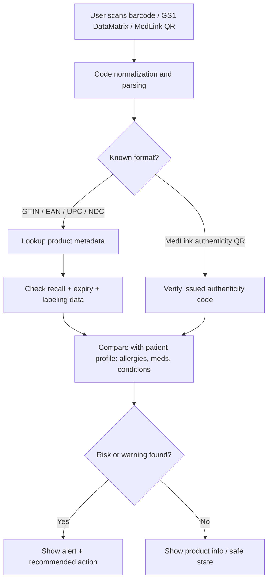
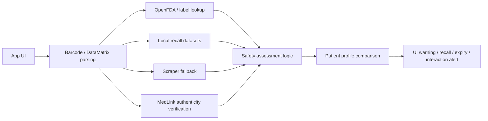
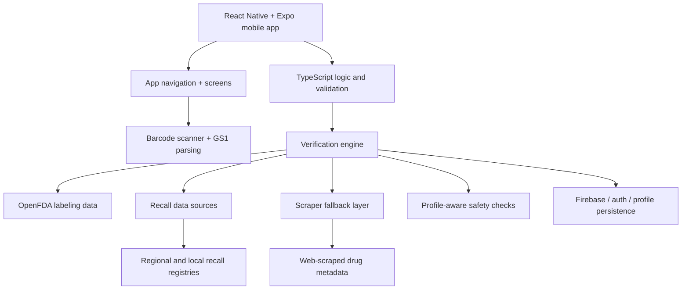

# MedLink Mobile

MedLink is an Africa-focused medication verification app built to help people check what they are buying or taking, flag suspicious products, and understand the risk around counterfeit, recalled, expired, or poorly matched medicines.

This project started from a very practical problem: in many markets, including across Africa, counterfeit and substandard medicines are easier to move when people cannot quickly verify packaging, product origin, or known safety signals. The app is meant to give patients, caregivers, and pharmacy-facing teams a faster way to cross-check medicine information before it reaches the patient.

> This project is not a clinical decision system and it is not a replacement for a doctor or pharmacist. It is a safety and verification tool meant to support informed decisions, not replace professional care.


## Why this exists

The problem is not just one bad batch or one fake box. It is a bigger system issue:

- medication packaging is not always traceable at the point of sale,
- patients may not know the product name, active ingredients, or legal origin,
- counterfeit products can look convincing enough to fool a rushed buyer,
- side effects and allergies can be missed when the patient has no quick way to compare their profile against the medication,
- some markets do not have strong digital traceability or recall visibility at the point of care.

MedLink is designed to make that process less fragile by putting a few critical checks into one mobile workflow: scan, verify, check recall risk, compare against the patient record, and surface the warning where it matters.

## The African context

This project is intentionally shaped around the realities of African healthcare and consumer markets.

Why that matters:

- counterfeit medicines are a major risk in many African countries,
- poor packaging and supply-chain visibility make verification harder,
- many consumers rely on pharmacies, informal sellers, or local clinics that need better product intelligence,
- region-specific recall and compliance data matters more than a generic one-size-fits-all product view,
- a mobile-first tool can help close the gap between medicine packaging, patient data, and local safety information.

This is not a purely US-centric product. It is meant to be useful in African contexts, with room for country-specific recall coverage, pharmacy workflows, and product verification patterns that reflect real market conditions.

## What the app does

At a high level, MedLink brings together a few important functions:

- barcode and GS1/DataMatrix scanning,
- product lookup and verification workflows,
- authenticity checks for MedLink-issued codes,
- recall and expiry screening,
- patient profile comparison for allergies, conditions, and current medication history,
- reminder and medication management tools,
- facility and clinic/pharmacy discovery,
- multilingual support for different user contexts.

## Main app areas

This repo includes the main surfaces that drive the product:

### Dashboard

The dashboard acts as the home layer for the patient or user: reminders, summary information, schedule awareness, and quick access to essential tools.

### Scanner and verification

The scanner is at the heart of the project. It handles product scanning, code parsing, lookup, and warnings for recall, authenticity, or expiry-related issues.

### Patient profile

The profile layer is where a user stores medical context such as allergies, medications, conditions, emergency information, and pharmacy-related details. This is important because verification works much better when it can compare a scanned product against the real person using it.

### Facilities and pharmacies

The app also includes facility discovery for clinics, hospitals, and pharmacies, which matters in settings where people need to find trusted care or purchase medicines from a known source.

## How the app works

The core flow is simple on the surface but layered underneath: scan a product, normalize the code, check what is known about it, compare it to the patient record, and then surface the right warning or confidence signal.



### Product verification pipeline

The app currently pulls together a few layers of verification rather than depending on one single lookup source.



### Technology and source stack



### Where the app gets its information

The verification engine is designed to use multiple data sources rather than a single API, which is important in markets where product and recall data is uneven.

- Product and labeling data: OpenFDA and related public metadata sources
- Recall checks: local/regional recall registries and public enforcement data
- Safety logic: patient profile comparisons for allergies, recorded medications, and medical conditions
- Offline and low-coverage fallback: local recall datasets and scraper-driven metadata lookup
- Authenticated user context: Firebase-based profile and reminder persistence

This layered approach is intentional: the app is designed for a world where one source may be incomplete, delayed, or unavailable.

## Current project status

This is a working mobile app and a serious project foundation, but it is still best treated as an evolving safety tooling project rather than a fully regulated clinical product.

### What is already in place

- mobile app shell and navigation,
- barcode verification workflow,
- product and recall lookup logic,
- user profile management,
- reminder and dashboard views,
- clinic / pharmacy discovery screens,
- multilingual support,
- region-aware recall and data-building scripts.

### What still needs work

This is the honest part:

- some features depend on public data sources that are incomplete or inconsistent,
- risk checks can be limited by source coverage and region,
- product verification is not the same as a complete patient assessment,
- some barcode and product-matching edge cases still need cleanup,
- the app would need stronger legal, privacy, and safety review before broader deployment,
- a production-grade rollout would require deeper field validation across countries and regulatory contexts.

## Known limitations

MedLink is useful, but it has clear limits.

- public databases may not cover every medication or every market,
- recall and product data can be outdated or incomplete,
- not every product code will match perfectly across markets,
- interaction and contraindication logic can be limited by the quality of the data source,
- counterfeit detection is probabilistic, not absolute,
- package-level checks do not replace a clinician's judgment.

## Safety note

MedLink is intended for general reference and awareness, not as a medical diagnosis tool. It should never be treated as a substitute for a qualified healthcare professional, pharmacist, or emergency clinician.

Users should always confirm product safety, dosage, and appropriateness with a licensed professional when the stakes are high.

## Project structure

```text
.
├── App.tsx
├── package.json
├── README.md
├── CONTRIBUTING.md
├── START_HERE.md
├── QUICK_START.md
├── DRUG_SAFETY_SYSTEM.md
├── DRUG_VERIFICATION_AUDIT.md
├── IMPLEMENTATION_SUMMARY.md
├── TROUBLESHOOTING.md
├── src/
│   ├── components/
│   ├── core/
│   ├── hooks/
│   ├── i18n/
│   ├── lib/
│   ├── notifications/
│   ├── scan/
│   ├── screens/
│   ├── services/
│   ├── theme.ts
│   └── utils/
├── autoscrape/
├── server/
├── scripts/
├── docs/
├── __tests__/
├── app.json
├── babel.config.js
├── metro.config.js
└── tsconfig.json
```

## Local setup

### Prerequisites

- Node.js 18+
- npm
- Expo / React Native tooling
- optional: Python for scraper and fallback data work

### Install

```bash
npm install
```

### Run the app

```bash
npm start
```

### Run with scraper support

```bash
npm run start:full
```

## Screens and core flows

This repo does not currently include a full exported screenshot gallery in the project itself, but the main user flows are clear from the app structure and screen files:

- Dashboard / overview
- Barcode scanner and verification result view
- Product details and safety warnings
- User profile and medication history
- Facility, clinic and pharmacy lookup
- Reminder management and medication schedule

## Testing

The repository includes Jest tests around verification and scanning logic. To run the test suite:

```bash
npm test
```

If you are working on barcode logic, safety checks, or product validation, it is worth running the most relevant tests before merging changes.

## Contributing

This project is big enough for a lot of different kinds of contributors, and that is part of the point. We need people working on:

- mobile UI and screen flow improvements,
- barcode and product verification logic,
- safety warnings and data quality,
- Africa-focused recall and registry coverage,
- facility and pharmacy discovery,
- testing and regression work,
- documentation and onboarding clarity.

See [CONTRIBUTING.md](CONTRIBUTING.md) for the contribution guide and workflow.

## Documentation index

- [START_HERE.md](START_HERE.md) — quick-start setup notes
- [QUICK_START.md](QUICK_START.md) — operational overview
- [DRUG_SAFETY_SYSTEM.md](DRUG_SAFETY_SYSTEM.md) — safety system notes
- [DRUG_VERIFICATION_AUDIT.md](DRUG_VERIFICATION_AUDIT.md) — audit and known gaps
- [IMPLEMENTATION_SUMMARY.md](IMPLEMENTATION_SUMMARY.md) — implementation notes and changes
- [TROUBLESHOOTING.md](TROUBLESHOOTING.md) — common issues and fixes

## License

This project currently declares the 0BSD license in [package.json](package.json), but anyone working on healthcare-facing tooling should treat legal review and safety review as part of the development process, not an afterthought.

## Closing note

This is a project with real social value if it is built carefully. The goal is not just to make a fancy scanner. The goal is to create a useful, honest, and practical product that helps people avoid bad medicine in places where the risk is too high and the margin for error is too low.

That is why the project is being shaped around the African context and why the app is being built with real-world verification, profile awareness, and safety logic in mind.
